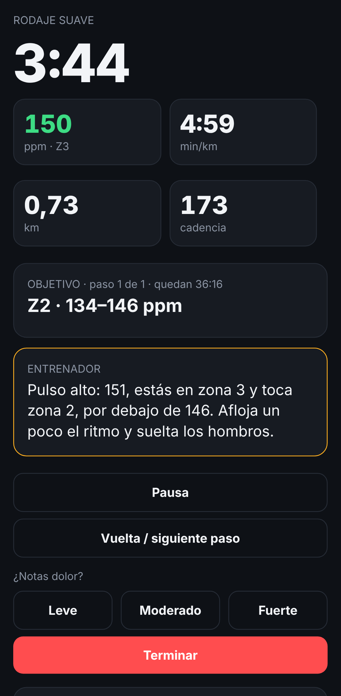
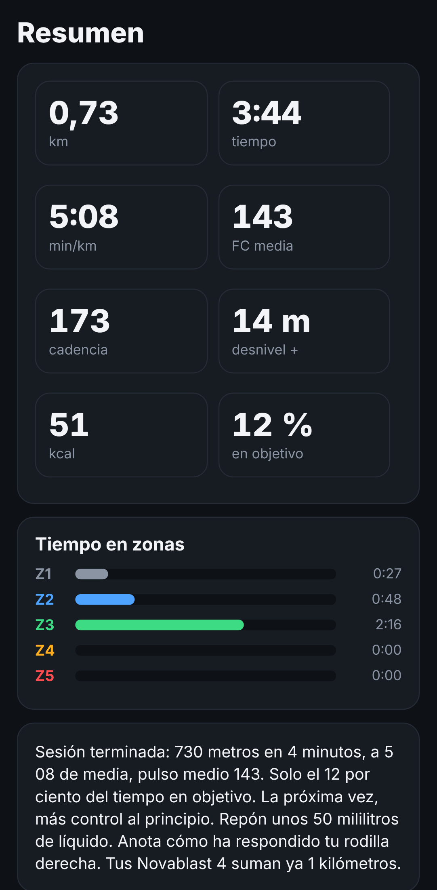

# EarPace — tu entrenador de carrera al oído

App para corredores con reloj Garmin. Durante un entrenamiento o una competición te va
orientando **por voz** (auriculares conectados al móvil) y **en el reloj** (texto + vibración),
como un entrenador que te habla por un pinganillo.

| En carrera | Resumen |
|---|---|
|  |  |

## Qué tiene en cuenta

| Dato | De dónde sale | Para qué lo usa |
|---|---|---|
| Plan de entrenamiento y objetivo | Importado (JSON), plan de ejemplo o competición añadida a mano | Sesión del día, pasos y series, días que faltan para el objetivo |
| Zonas de FC, peso, FC en reposo | Tu Garmin (se leen del reloj al conectar) o a mano | Objetivo de pulso, hidratación, kcal, vida de la zapatilla |
| Pulso, cadencia, ritmo, altitud, rumbo | Reloj en vivo (cada 3 s) | Correcciones durante la carrera |
| Desnivel global y actual | GPX del recorrido o altímetro | Avisa antes de cada subida/bajada; en cuesta manda el pulso |
| Temperatura, humedad, viento y dirección | Open-Meteo según tu posición | Ajusta ritmos por calor, avisa de viento de cara/a favor, hidratación |
| Zapatillas y kilómetros | App móvil | Desgaste, zapatilla inadecuada para el terreno |
| Terreno | App móvil | Ajuste de ritmo y consejos de técnica |
| Entrenamientos y descansos previos, sueño | Historial de la app | Carga aguda/crónica: «llegas cargado, recorta» |
| Lesiones actuales y pasadas, con su evolución | App móvil | Limita zona y duración, cuidado en bajadas, pregunta por el dolor |

Además: deriva cardíaca, caída de cadencia por fatiga, alerta de pulso máximo, avituallamiento
en tiradas largas y, en competición, control de la salida, parciales contra tu objetivo y empuje final.

## Estructura

```
packages/coach-engine   Motor del entrenador (TypeScript puro, 33 tests)
apps/mobile             App Android + iOS (Expo / React Native)
  modules/garmin-link   Puente nativo con el reloj (Connect IQ Mobile SDK)
apps/watch              App del reloj (Connect IQ, Monkey C)
```

El reloj graba la actividad (se sincroniza con Garmin Connect como cualquier carrera), envía los
datos al móvil y muestra las indicaciones que este devuelve. El móvil ejecuta el motor completo y
habla. Si el móvil se queda sin conexión, el reloj sigue con un entrenador reducido (pasos del
entrenamiento, zona de pulso, parciales y alerta de pulso máximo).

## Probarlo

```bash
npm install
npm test                 # tests del motor
npm run simulate         # imprime lo que diría el entrenador en una carrera simulada
cd apps/mobile && npx expo start --web   # la app en el navegador; elige la fuente «Demo»
```

En un móvil real hace falta una compilación de desarrollo (el enlace con Garmin es código nativo y
no funciona en Expo Go): `npx eas-cli build --profile development`.

Reloj: instala el [SDK de Connect IQ](https://developer.garmin.com/connect-iq/sdk/) y la extensión
«Monkey C» de VS Code, abre `apps/watch` y ejecuta *Monkey C: Build for Device*.

## Estado: qué está comprobado y qué no

- **Comprobado aquí:** motor (tests y simulación), tipos de toda la app móvil, empaquetado JS para
  Android, iOS y web, y recorrido completo en navegador con la carrera de demostración.
- **Sin compilar todavía** (el entorno donde se escribió no tiene los SDK):
  - la app del reloj — requiere el SDK de Connect IQ; espera ajustes menores al primer build;
  - el puente nativo: el de Android está contrastado con las firmas del SDK 2.4.0 de Garmin; el de
    iOS está escrito de memoria contra el SDK de Garmin y es lo más probable que necesite retoques.
- **iOS:** descarga `ConnectIQ.xcframework` de
  [garmin/connectiq-companion-app-sdk-ios](https://github.com/garmin/connectiq-companion-app-sdk-ios)
  y cópialo en `apps/mobile/modules/garmin-link/ios/`.

## Limitaciones de la plataforma Garmin

- **Plan de entrenamiento:** Garmin no ofrece una API pública para *leer* tu plan de Garmin Coach
  ni tu calendario de Connect (su Training API solo permite *enviar* entrenamientos y exige alta
  como empresa). Por eso el plan se importa como JSON (formato en
  `packages/coach-engine/src/types.ts`, tipo `TrainingPlan`).
- **Voz en el reloj:** las apps Connect IQ no pueden sintetizar voz; el audio sale del móvil.
- **Zapatillas e historial de Garmin Connect:** no están expuestos a apps de terceros; se llevan en la app.

## Publicación

Las tres tiendas requieren cuentas a tu nombre:

1. **Connect IQ Store** — cuenta de desarrollador Garmin (gratuita). *Monkey C: Export Project*
   genera el `.iq`; se sube en <https://apps.garmin.com/developer>. Revisión de Garmin: unos días.
2. **Google Play** — cuenta de desarrollador (25 USD, pago único).
   `npx eas-cli build -p android --profile production && npx eas-cli submit -p android`.
3. **App Store** — Apple Developer Program (99 USD/año).
   `npx eas-cli build -p ios --profile production && npx eas-cli submit -p ios`.

Antes de enviar: política de privacidad (se tratan datos de salud y ubicación; hoy todo se guarda
solo en el dispositivo), iconos y capturas definitivos, y probar con relojes reales.

## Aviso

EarPace orienta el entrenamiento; no es un producto sanitario ni sustituye a un médico o
fisioterapeuta. Los ajustes por calor, viento, pendiente y carga son aproximaciones.
